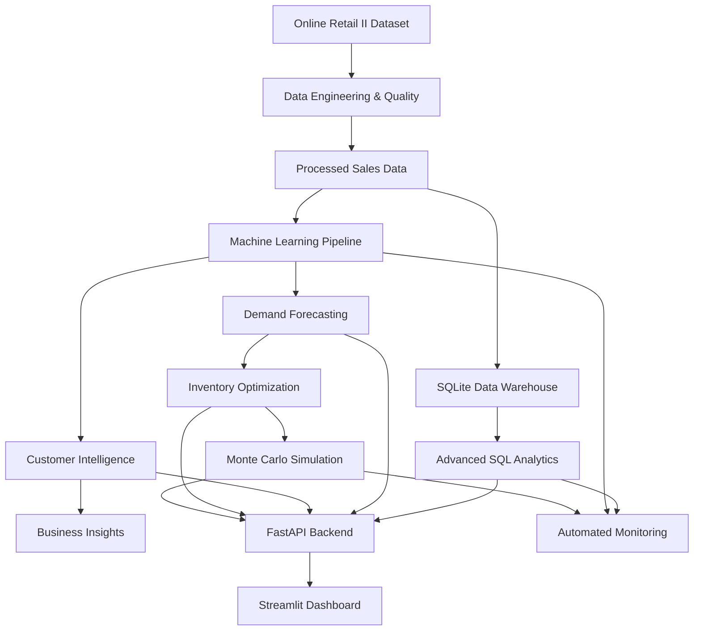

# Retail Business Intelligence & Inventory Optimization System

### An End-to-End Data Analytics, Machine Learning & Inventory Intelligence Platform

A comprehensive retail analytics and decision-support system designed to transform transactional sales data into actionable business insights through data engineering, advanced SQL analytics, machine learning-based demand forecasting, customer intelligence, and inventory optimization.

The platform integrates Python, SQL, Machine Learning, FastAPI, Streamlit, and Docker to support data-driven retail decision-making.

---

## Project Overview

Retail businesses face several challenges, including uncertain customer demand, inefficient inventory management, customer retention, and limited visibility into sales performance.

This project addresses these challenges through an integrated Business Intelligence and Machine Learning platform.

The system processes retail transaction data, develops predictive models, performs customer segmentation, simulates inventory policies, and presents analytical insights through an interactive dashboard and REST API.

## Key Features

### 1. Data Engineering & Quality Management
- Data cleaning and preprocessing
- Missing-value and duplicate detection
- Data validation and quality reporting
- Automated ETL workflow
- Pipeline logging and error handling

### 2. Advanced SQL & Data Warehousing
- SQLite-based data warehouse
- Star Schema architecture
- Fact and dimension tables
- SQL Common Table Expressions (CTEs)
- Window functions and ranking
- Monthly revenue and year-over-year analysis
- Customer cohort and repeat-purchase analysis

### 3. Advanced Demand Forecasting
- Weekly product-level demand aggregation
- Time-series feature engineering
- Lag and rolling-window features
- XGBoost and LightGBM
- Time-series validation
- Optuna hyperparameter optimization
- MAE, RMSE and WAPE evaluation
- Recursive multi-week demand forecasting

### 4. Explainable AI
- SHAP feature importance
- Global and local prediction explanations
- Actual vs. predicted analysis
- Residual analysis
- Forecast error monitoring

### 5. Customer Intelligence
- RFM analysis
- Customer segmentation
- K-Means clustering
- Customer Lifetime Value (CLV) scenarios
- Historical 90-day inactivity prediction
- Churn model evaluation

### 6. Inventory Optimization
- ABC-XYZ product classification
- Safety stock calculation
- Reorder Point (ROP)
- Economic Order Quantity (EOQ)
- Inventory policy comparison
- Monte Carlo demand simulation
- Stockout probability and fill-rate analysis
- Inventory cost scenarios

### 7. Business Intelligence Dashboard
A multi-page Streamlit dashboard featuring:

- Executive Overview
- Sales Analytics
- Customer Intelligence
- Demand Forecasting
- Inventory Optimization
- Monte Carlo Simulation

### 8. REST API
FastAPI endpoints for:

- System health monitoring
- Business overview
- Product demand forecasts
- Inventory recommendations
- Customer profiles
- Historical churn-risk estimates

### 9. Automation & Deployment
- Automated analytics pipeline
- Unit and integration testing
- Data drift monitoring
- Forecast performance monitoring
- GitHub Actions CI workflow
- Docker and Docker Compose configuration

---

## System Architecture



---

## Technology Stack

| Category | Technologies |
|---|---|
| Programming Language | Python 3.12 |
| Data Analysis | Pandas, NumPy |
| Data Visualization | Matplotlib, Seaborn, Plotly |
| Database | SQLite, SQL |
| Machine Learning | Scikit-learn, XGBoost, LightGBM |
| Hyperparameter Tuning | Optuna |
| Explainable AI | SHAP |
| Customer Analytics | RFM, K-Means, CLV, Churn Modeling |
| Dashboard | Streamlit |
| Backend API | FastAPI, Pydantic |
| Testing | Pytest |
| Automation | Python, GitHub Actions |
| Containerization | Docker, Docker Compose |
| Version Control | Git, GitHub |

---

## Dataset

The project uses the **Online Retail II** transactional dataset.

The dataset contains retail transaction information, including:

- Invoice numbers
- Product identifiers
- Product descriptions
- Purchase quantities
- Invoice dates
- Unit selling prices
- Customer identifiers
- Countries

The dataset is used for sales analytics, product demand forecasting, customer analysis, and inventory decision-support experiments.

The original dataset is not included in this repository. Users must obtain it separately and place it in the appropriate local data directory.

---

## Project Structure

```text
Retail-Business-Intelligence-Inventory-Optimization/
│
├── dashboard_app.py
├── app.py
├── requirements.txt
├── requirements-ci.txt
├── README.md
├── .gitignore
├── .dockerignore
│
├── data/
│   ├── raw/
│   ├── processed/
│   └── warehouse/
│
├── src/
│   ├── data_engineering/
│   ├── database/
│   ├── forecasting/
│   ├── customer_intelligence/
│   ├── inventory/
│   ├── monitoring/
│   ├── automation/
│   ├── api/
│   └── dashboard/
│
├── sql/
│   ├── schema.sql
│   └── advanced_analytics.sql
│
├── models/
│   ├── forecasting/
│   ├── clustering/
│   └── churn/
│
├── reports/
│   ├── advanced_forecasting/
│   ├── advanced_ml_forecasting/
│   ├── optuna_forecasting/
│   ├── explainable_ai/
│   ├── customer_analytics/
│   ├── abc_xyz/
│   ├── inventory/
│   ├── simulation/
│   ├── monte_carlo_inventory/
│   ├── sql_analytics/
│   └── monitoring/
│
├── tests/
│
├── deployment/
│   ├── Dockerfile
│   ├── docker-compose.yml
│   └── requirements-runtime.txt
│
└── .github/
    └── workflows/
        └── ci.yml
```

---

## Installation & Setup

### 1. Clone the Repository

```bash
git clone https://github.com/imuakhi/Retail-Business-Intelligence-Inventory-Optimization.git

cd Retail-Business-Intelligence-Inventory-Optimization
```

### 2. Create a Virtual Environment

```bash
python -m venv .venv
```

Activate on Windows:

```powershell
.venv\Scripts\Activate.ps1
```

### 3. Install Dependencies

```bash
python -m pip install --upgrade pip
python -m pip install -r requirements.txt
```

### 4. Prepare the Dataset

Place the downloaded Online Retail II workbook in the local data directory.

Run the data preprocessing scripts to generate:

```text
data/processed/clean_sales.csv
```

The raw dataset and processed customer-level data are excluded from version control.

---

## Running the Project

### Data Engineering

```bash
python 02_data_cleaning.py
```

### Data Warehouse

```bash
python -m src.database.database
```

### SQL Analytics

```bash
python -m src.database.run_queries
```

### Demand Forecasting

```bash
python -m src.forecasting.global_demand_forecasting
```

### Hyperparameter Optimization

```bash
python -m src.forecasting.optuna_tuning
```

### Explainable AI

```bash
python -m src.forecasting.explain_forecasting
```

### Customer Intelligence

```bash
python -m src.customer_intelligence.customer_intelligence
```

### Monte Carlo Inventory Simulation

```bash
python -m src.inventory.monte_carlo_inventory
```

### Monitoring

```bash
python -m src.monitoring.monitoring
```

### Streamlit Dashboard

```bash
streamlit run dashboard_app.py
```

Dashboard URL:

`http://localhost:8501`

### FastAPI Backend

```bash
python -m uvicorn src.api.main:app --reload --host 127.0.0.1 --port 8000
```

API Documentation:

`http://127.0.0.1:8000/docs`

---

## Docker Deployment

Ensure Docker Desktop is installed and the Docker Engine is running.

Build and start the services:

```bash
docker compose -f deployment/docker-compose.yml up -d --build
```

Check running containers:

```bash
docker compose -f deployment/docker-compose.yml ps
```

Stop the services:

```bash
docker compose -f deployment/docker-compose.yml down
```

The application provides two services:

| Service | Local URL |
|---|---|
| Streamlit Dashboard | http://localhost:8501 |
| FastAPI Backend | http://localhost:8000 |
| API Documentation | http://localhost:8000/docs |

Note: The local dataset, trained models, reports, and warehouse database are excluded from the repository. Prepare the required local artifacts before running the complete application.

---

## Testing

Run the project tests:

```bash
python -m pytest tests -v
```

Compile Python modules:

```bash
python -m compileall -q src tests dashboard_app.py
```

The GitHub Actions workflow is configured to perform automated compilation and test checks.

---

## Important Assumptions & Limitations

This is a portfolio and analytical decision-support project based on historical retail transactions. Some operational inventory information is not available in the original dataset.

Therefore:

- Current stock levels may be simulated.
- Supplier lead times may be assumed.
- Unit costs may be estimated from selling prices.
- Ordering and holding costs may use configurable assumptions.
- Monte Carlo results represent simulated scenarios, not verified company outcomes.
- CLV profit estimates use illustrative margin and customer-lifespan assumptions.
- Churn prediction uses historical 90-day purchase inactivity as a proxy; it does not guarantee future customer behaviour.
- Historical data ends in 2011, so model predictions should not be interpreted as current retail market forecasts without recent training data and validation.

These limitations are documented to distinguish observed transaction data from simulated business assumptions.

---

## Future Improvements

- Real-time retail data integration
- Probabilistic demand forecasting
- Advanced time-series models
- Improved probability calibration for churn prediction
- Live inventory and supplier integrations
- Role-based API authentication
- Cloud deployment
- Advanced model monitoring
- Automated retraining and orchestration

---

## Project Author

**Akhi Akter**

Aspiring Data Analyst | Data Scientist | Machine Learning Enthusiast

GitHub: https://github.com/imuakhi

---

## License

No open-source license has been assigned to this repository yet.
